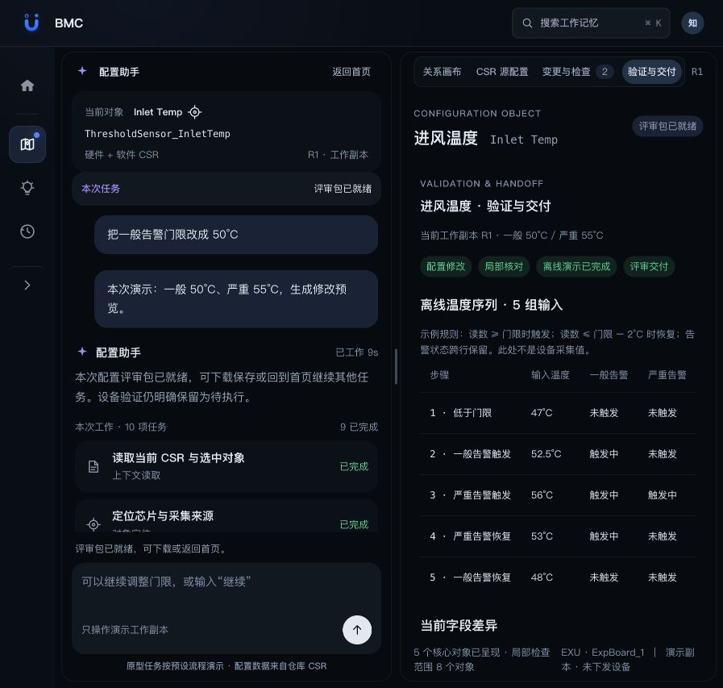

# CSR 对话与配置画布原型

推荐从[工作地图与 CSR 协作首页](../工作地图-CSR协作.html)进入，在首页输入“把一般告警门限改成 50°C”，会进入原框架内的左侧对话、右侧配置画布。也可[单独打开原型](./index.html)。从 BMC-explore 根目录启动静态预览服务可完整体验。

左侧是对象上下文、对话、任务类型、状态与决策卡；右侧是与任务同步的对象关系画布、CSR 源配置和变更检查。分栏可拖动或用键盘调整；窄屏按对话、画布顺序排列。

## 体验路径

1. 点击“开始配置演示”，读取真实 `ThresholdSensor_InletTemp`，逐步显示芯片、Scanner 和告警事件。
2. 观察一般门限 50 与严重门限 48 的冲突，填写演示严重门限 55，或保留原配置。
3. 生成预览时，右侧同时显示原值 46/48 与待应用值 50/55。
4. 应用工作副本，画布与关联事件更新；检查卡说明范围与未执行项。
5. 查看差异、定位对象、查看源码、修改历史、撤销，或暂停再继续。
6. 点击“继续验证与交付”，选择离线告警演示、填写设备验证计划，或记录未验证项后继续交付。没有设备环境时不再停在提示卡上。
7. 离线演示展示 5 组温度输入及两级告警触发、恢复状态；规则为演示逻辑，不能替代设备验证。
8. 审阅字段差异及未验证项后，生成并下载 ZIP 评审包。包内包含软硬件 CSR、变更记录、局部检查、离线演示结果、设备验证计划和说明。
9. 返回首页查看当前任务；重新进入或刷新会保留同一任务进度。状态保存在当前浏览器本地存储中。

## 任务类型和状态

| 类型 | 对应工作 |
|---|---|
| 上下文读取 | 解析硬件、软件 CSR，并识别选中对象 |
| 对象定位 | 查找 I2c_8、Lm75_InletTemp 和 Scanner |
| 引用分析 | 追踪两个 Event.Condition 引用 |
| 约束检查 | 核对一般门限低于严重门限的示例规则 |
| 变更生成 | 生成字段级差异 |
| 配置修改 | 核对版本、应用演示工作副本 |
| 局部校验 | 检查门限顺序与引用目标存在性 |
| 离线演示校验 | 根据当前工作副本计算示例温度序列的触发与恢复 |
| 交付生成 | 核对审阅状态和版本，生成 ZIP 评审包 |
| 运行时验证 | 记录设备环境、规格及验证计划；实际执行仍为未执行 |

卡片显示进行中、已完成、待决策、已暂停或未执行。步骤可展开查看依据；点击定位会在画布选中对应对象。读取时会真实尝试严格 JSON 解析，并在遇到原样例注释后使用识别字符串的兼容方式恢复。

## 数据和能力边界

真实对象、字段和 8 个对象的 21 处引用来自[流程文档与证据](../../docs/竞品库/HeyPCB-AI-PCB设计工作台/BMC借鉴案例-进风温度/README.md)。`data.js` 固化这一版仓库样例，50/55 仅是演示输入，不是正式散热规格。

任务执行采用本地预设步骤，没有连接真实大模型或 BMC，也没有修改源工程文件。用户可在输入框调整本对象的一般告警门限；原型不支持任意自然语言任务。局部引用检查不代表固件属性、默认回退或设备行为已验证。

“导出工作副本”及评审包基于原始硬件文件文本替换所选门限，保留注释及其他字段。软件文件的默认回退值不随本次示例变更自动改写。评审包不包含固件构建、签名或部署结果。

## 首页衔接

`host.js` 与 `host.css` 将配置会话嵌入既有框架，复用顶部栏及侧栏；通过带来源校验的消息同步首页任务卡。首页把需求和任务标识传给内嵌页面，首次进入自动开始，返回和恢复不重启任务。原风扇板流程仍可从首页按钮进入。`completion.js` 管理后续验证、审阅及 ZIP 生成。

## 设计系统复用

- 使用仓库现有 PTO 基础 token、按钮、分段控制、卡片和 `ide-frame.css`。
- 直接嵌入 `ide-frame` 与 `workbench-shell`：两栏内容由用户明确指定；共享运行文件负责分栏拖动、键盘和尺寸保存。
- 共享运行文件在 `web-app/public/pto-runtime`，来源和 SHA-256 记录于 `SOURCES.json`。
- 本页面是原型预览。没有新增需要审批的视觉组件；领域图节点及连线使用真实 CSR 关系。

## 已完成的核对

- 脚本语法及仓库 UI 样式检查通过。
- 浏览器实际走通：门限冲突、非法严重门限阻止、确认方案、预览、应用、局部检查、查看差异、撤销。
- 浏览器实际走通：任务暂停后保留当前步骤、继续生成预览；刷新后保留对象版本和工作状态。
- 浏览器实际走通：首页输入 → 约束选择 → 预览与应用 → 离线演示 → 审阅并生成评审包 → 下载 → 返回首页 → 刷新后恢复。
- ZIP 内容核对：7 个文件、硬件门限 50/55、设备验证标记为 false；脚本语法检查通过。
- 已接入此静态框架；未执行真实模型、设备连接或固件校验。

## 线上发布

发布入口保留为 `BMC-探索/工作地图-CSR协作.html`。共享样式和运行文件的同版本副本放在 `shared/`，避免静态发布时引用未被打包的源码目录；来源与 SHA-256 记录在 `shared/SOURCES.json`。沿用现有 Pages workflow。
