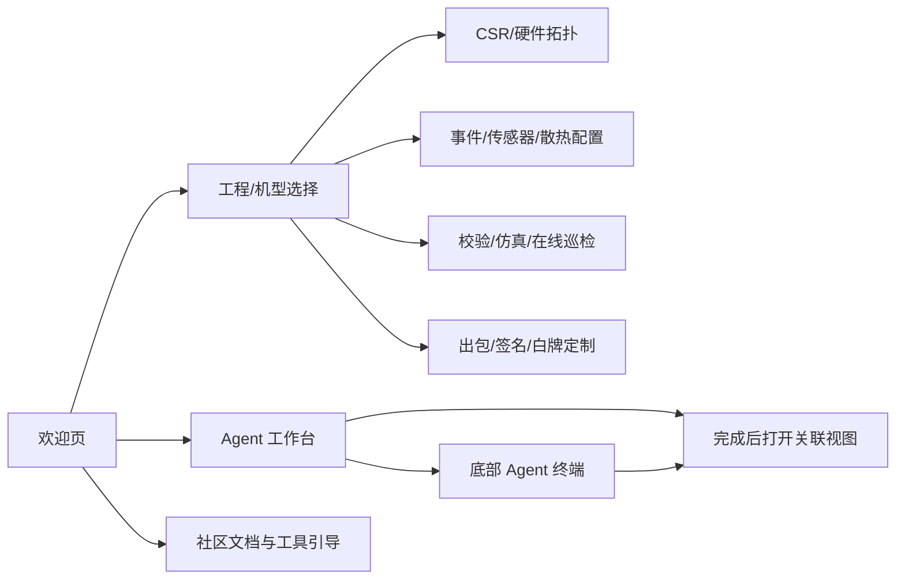

# openUBMC Studio 现有工作台基线分析

> 分析对象：`BMC-explore` 当前 `main` 快照（commit `555c7e4`）。
> 目的：在 Q4 欢迎页和任务流优化之前，建立对现有工作台的信息架构、用户、能力边界和任务流的共同理解。

## 结论先行

当前仓库实现的是一个**面向整机开发者 / 硬件适配工程师的 IDE 型 BMC 工作台**，不是面向数据中心值班运维的在线 BMC 监控控制台。

现有产品核心价值是：

> 让工程师围绕一个整机项目，加载或编辑 CSR/PSR 相关数据，查看硬件与软件对象的关联，配置传感器和事件，进行拓扑/仿真/环境诊断，并完成校验和出包。

当前工作台的组织方式仍然明显偏“工具集合”：入口多、视图多、技术术语密集；已经具备 Agent、项目、拓扑、仿真等任务化基础，但主任务流还没有被统一为一条清晰的“从环境准备到发布”的路径。

## 1. 代码与产品边界

### 1.1 仓库包含的产品层

| 层 | 代码证据 | 产品含义 |
|---|---|---|
| IDE 壳层 | `web-app/src/App.tsx` | 顶栏、活动栏、Tab、多 Pane、终端、AI 面板 |
| 欢迎/启动 | `web-app/public/welcome.html` | 新建/导入工程、工作流、Agent 工作台、最近打开、文档入口 |
| 项目选择 | `web-app/src/components/ProjectList.tsx`、`data/projects.ts` | 选择整机项目或上传 `.sr/.json` |
| CSR/硬件配置 | `TopologyView`、`TianChiBoardTopologyView`、`HardwareTopologyCanvas` | 查看和编辑拓扑、板卡、硬件对象 |
| 规则配置 | `EventConfig`、`EventDefManager`、`SensorConfig`、`CoolingConfig` | 事件、传感器、阈值、散热规则 |
| 运行验证 | `Simulator`、`BmcEnvView`、`AgentTerminal` | 仿真、在线 BMC 巡检、Agent 命令执行 |
| 构建交付 | `CsrExportPanel`、`SigningConfigPanel`、`WhiteBrandPanel` | CSR 出包、签名证书、白牌定制 |

### 1.2 不应误判为当前已完成的能力

- 它不是完整的 BMC 运行时管理前端。
- 真实的 Web/Redfish/SNMP 线上运维界面不在该仓库中。
- 仓库中的很多页面是原型、模拟器、占位页或预览能力。
- `web-app` 是主 React 原型；`web-app-vue`、`csr-topology-editor/web-app` 和 VS Code WebView 是并存的探索/复用实现，不应直接视为多个正式产品。

## 2. 当前工作台的用户模型

### 核心用户

**整机开发者 / 硬件适配工程师**：能够理解 CSR、PSR、BOM、I²C、SMC、Scanner、Event 等术语，工作目标是把一款服务器或板卡适配进 BMC 软件。

### 次要用户

| 角色 | 使用目的 | 当前对应入口 |
|---|---|---|
| BMC 软件工程师 | 查询资源接口、路径、构建和日志 | 资源管理器、Agent、终端、日志解析 |
| 测试工程师 | 验证传感器、告警、链路和故障行为 | 仿真调试、事件、传感器、BMC 环境 |
| 架构/技术负责人 | 查看整机拓扑和进度 | 项目卡片、硬件拓扑、3D/服务器视图 |
| 新成员 | 安装环境并了解工具 | 安装引导、文档、AI 引导安装 |

### 不应作为默认核心用户

数据中心一线运维人员不是当前工作台的第一目标用户。仓库没有完整的在线服务器资产、告警闭环、远程电源、固件批量运维信息架构。Q4 如果要支持他们，需要先确认是否要扩大产品边界。

## 3. 当前信息架构



### 现有一级入口

当前 `App.tsx` 活动栏包含：欢迎页、AI 助手、资源管理器、安装部署、表达式/SMC/调速工具、BMC 环境、日志解析、硬件适配、签名证书、白牌定制、CSR 拓扑、事件管理、仿真调试。

另有“更多功能 · 预览”菜单收纳：硬件拓扑、3D 仿真、拓扑视图、软硬件关联、传感器、服务器视图和代码辅助扩展。

### 当前导航模型的特征

- IDE 型左侧活动栏 + 多 Tab + 可拖拽分屏。
- 视图可独立打开，也可被 Agent 任务完成后打开。
- CSR 依赖型视图在没有加载文档时会自动加载示例项目。
- 当前工程显示在顶栏；工程切换后会弹出“当前工程可用能力”提示。
- 还没有真正围绕“用户要完成的任务”组织成任务中心或进度中心。

## 4. 当前欢迎页是什么

`welcome.html` 当前主要包含：

1. 品牌与版本提示。
2. “导入工程”和“新建工程”。
3. 工作流程：环境部署 → 开发 → 调试 → 构建 → 测试 → 发布。
4. Agent 工作台：自然语言输入、AI 引导安装、MCP 能力快捷任务、最近 Agent 对话。
5. 最近打开。
6. 社区文档与工具引导。

工作流数据在页面中以步骤和子步骤表达，并有 released/unreleased 状态。它已经是未来 Welcome 工作台的基础，但当前更接近“能力导航 + 状态展示”，还不是完整任务编排。

## 5. 关键任务流现状

### 任务流 A：进入一个整机项目

```text
打开工作台
→ 欢迎页选择项目或上传 .sr/.json
→ 读取 root.sr
→ 加载 CSR
→ 打开拓扑视图
→ 通过活动栏/更多菜单进入其他视图
```

关键约束：多数拓扑、事件、传感器、仿真视图需要先有 CSR；若没有，系统会尝试加载默认样例。

### 任务流 B：配置一个硬件能力

```text
加载工程
→ 进入硬件适配/拓扑
→ 编辑 ManagementTopology 或 Objects
→ 进入传感器/事件/散热配置
→ 在 Tab 行执行“校验当前 CSR”
→ 保存或 CSR 出包
```

### 任务流 C：用 Agent 完成任务

```text
欢迎页或 AI 面板输入任务
→ AgentTerminal 根据关键词匹配任务
→ 展示工具调用轨迹
→ 输出结果
→ 打开关联视图或回写向导状态
```

当前 Agent 任务包括环境诊断、BMC 巡检、CSR 校验、日志解析、过温事件、传感器配置、I²C 拓扑挂载、SMC 偏移、表达式、路径反查、风扇故障注入和调速曲线。

### 任务流 D：环境准备

```text
安装引导
→ 登录/代码仓权限
→ 检查 WSL、manifest、SDK、Conan、工具链
→ 配置检测
→ 失败时让 Agent 诊断/修复
→ 检测通过后进入选择机型/开发
```

仓库更新说明中已经明确了“失败横幅 → Agent 诊断修复 → 检测状态回写 → 解锁下一步”的闭环，这是现有最成熟的任务流之一。

## 6. 数据与领域对象

### 工程层

```text
HardwareProject
├── manufacturer
├── model
├── version
├── progressPercent
├── highlights
└── rootSrPath
```

工程卡片不只是文件入口，还承担机型身份、项目进度和关键硬件摘要。

### CSR 文档层

```text
CSRDocument
├── FormatVersion
├── DataVersion
├── Unit
├── ManagementTopology
└── Objects
```

### 拓扑视图层

`BoardTopologyModel` 将一个项目转换为：

- `boards`：板卡卡片
- `connectors`：板卡之间的连接器
- `devices`：芯片、Scanner、Event、ThresholdSensor、Component
- `links`：硬件对象与软件对象的关联

### 运行任务层

`AgentTask` 包含：关键词、任务标题、工具调用、输出、结果和关联视图。它说明当前工作台已经从“打开工具”向“描述任务”演化，但任务匹配仍然是静态关键词和模拟输出，未来需要产品化为可理解、可恢复、可追踪的任务实体。

## 7. 现阶段主要体验问题

以下结论分为代码事实和设计推断。

### 代码事实

- 工具入口数量多，部分成熟度差异通过“更多/预览”体现。
- 同一能力存在多个视图实现，例如 React 拓扑、Vue 拓扑、CSR 拓扑编辑器、硬件拓扑画布。
- 欢迎页已包含工作流，但主工作区主要仍按视图打开。
- 项目进度是静态数据，未见统一的任务状态模型。
- Agent 最近对话与本地存储、模拟任务状态关联。
- 多 Pane、多 Tab、底部终端和右侧 AI 面板会同时竞争用户注意力。

### 设计推断（需用同事访谈/真实使用确认）

- 新用户可能不知道先选“工程”、先做“环境”，还是直接打开工具。
- 技术用户能找到工具，但不一定知道某个工具在完整开发流程中的位置。
- “整机项目进度”与“当前个人待办任务”可能混在一起。
- Agent 执行成功后打开视图，可能仍缺少“我刚才做了什么、改了什么、下一步是什么”的解释。
- 入口过多会把 Welcome 页变成目录页，而不是用户回到工作台后的任务起点。

## 8. Q4 Welcome 页的基线建议

Welcome 页应优先承担四件事：

1. 告诉用户当前工程、当前阶段和阻塞项。
2. 让用户从高频任务开始，而不是从工具名称开始。
3. 让用户继续上次未完成的任务。
4. 在不隐藏完整工具集的前提下，降低第一次进入的选择成本。

建议将首页内容分成：

```text
当前工程与环境状态
→ 当前任务/待处理问题
→ 开发流程阶段
→ 高频任务入口
→ 最近工程与最近 Agent 任务
→ 完整工具/文档入口
```

## 9. Q4 任务流优化的优先研究对象

建议先研究以下三条，而不是同时改所有页面：

### 任务 1：首次进入并开始一个机型适配

关注：用户是否知道选择什么工程、需要什么前置环境、从哪里开始。

### 任务 2：为一个板卡完成拓扑—传感器—事件—校验—出包

关注：视图之间的上下文是否连续，当前工程和当前 CSR 是否持续可见，校验结果是否能定位到下一步。

### 任务 3：Agent 发现问题后完成修复并验证

关注：任务状态、执行证据、审批、失败恢复、结果回写和视图跳转是否形成闭环。

## 10. 设计评审时必须保留的产品事实

- `CSR` 和 `PSR` 是工程师模型，不应直接成为所有用户的一级导航。
- “工程”“机型”“板卡”“`.sr` 文件”“运行时对象”需要在界面中明确区分。
- “未配置”“未解析”“不支持”“读取失败”“校验失败”不能共用一个状态。
- 工具页可以保持专业密度，但 Welcome 页要负责翻译和分流。
- 物理硬件、软件对象和事件规则之间的关联是这个产品区别于普通 IDE 的核心价值。
- 任务流优化不能只做入口聚合，还要覆盖执行中、失败、恢复、校验和交付。

## 11. 可回查的代码入口

- `web-app/src/App.tsx`：壳层、路由、活动栏、Tab、Pane、Agent/工程状态。
- `web-app/public/welcome.html`：Welcome 页面结构、工作流和 Agent 工作台。
- `web-app/src/components/ProjectList.tsx`：按视图/按项目的入口卡片。
- `web-app/src/data/projects.ts`：整机项目数据模型和示例工程。
- `web-app/src/components/AgentTerminal.tsx`：Agent 任务词表、工具轨迹、结果和关联视图。
- `web-app/src/types.ts`：CSR、拓扑、板卡和软件/硬件关联的数据类型。
- `docs/RELEASE-NOTES.md`：已有交互决策和成熟度说明。
- `CLAUDE.md`：现有视觉约束、IDE 布局约束和欢迎页规范。

## 12. 当前判断的可信度

| 结论 | 来源 |
|---|---|
| 产品是 IDE 型开发工作台 | `App.tsx`、README、活动栏和多 Pane 实现，代码事实 |
| 主要用户是整机开发/硬件适配工程师 | 项目名称、CSR/PSR 工具链、README 和页面文案，代码事实 |
| Welcome 页已有工作流和 Agent 工作台 | `welcome.html`，代码事实 |
| 入口多且按视图组织 | `App.tsx`、`ProjectList.tsx`，代码事实 |
| 用户需要任务中心与阶段化导航 | 基于上述事实的设计推断，需用户访谈确认 |

