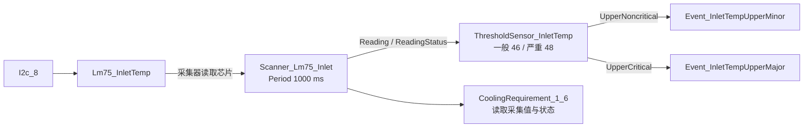
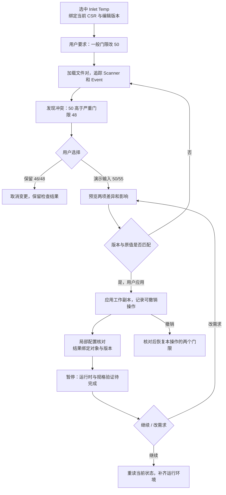

# 从一个真实 CSR 对象开始：修改进风温度告警门限

本案例把 HeyPCB 的需求澄清、工具进度、可编辑结果和暂停续接方式，转成 openUBMC Studio 中一条可评审的具体任务。

**真实起点：**仓库样例中的 `ThresholdSensor_InletTemp`。**示例请求：**“把这个进风温度传感器的一般告警门限改成 50°C，先让我看改动，再检查关联告警。”

对象、原始值和引用关系来自仓库。请求、后续对话和界面状态是设计稿文案；50/55°C 是评审演示输入，不是产品散热门限建议。当前交付包括文档、真实来源快照、演示副本、差异文件和本地核对结果；下述交互已形成独立本地原型，尚未接入实际业务工作台或真实 AI 代理。

[打开两栏交互原型](../../../../BMC-探索/csr-ai-workbench/index.html) · [原型说明与已核对路径](../../../../BMC-探索/csr-ai-workbench/README.md)

## 1. 先认识这个真实对象

| 内容 | 实际数据 | 来源 |
|---|---|---|
| 板卡 | `Unit.Type = EXU`，`Unit.Name = ExpBoard_1` | 硬件文件 `14100513_920s.sr` |
| 当前选中对象 | `ThresholdSensor_InletTemp`，显示名 `Inlet Temp` | 硬件与软件文件共同定义 |
| 一般告警门限 | `UpperNoncritical = 46` | 硬件文件 Objects |
| 严重告警门限 | `UpperCritical = 48` | 硬件文件 Objects |
| 读数来源 | `Reading = <=/Scanner_Lm75_Inlet.Value` | 软件文件 `14100513_920s_soft.sr` |
| 读数状态 | `ReadingStatus = <=/Scanner_Lm75_Inlet.Status` | 软件文件 |
| 采集器 | `Scanner_Lm75_Inlet`，`Period = 1000`，编辑器标注单位 ms | 硬件文件；`SensorConfig.tsx` |
| 芯片 | `Chip = #/Lm75_InletTemp` | 硬件文件中的 Scanner |
| 芯片所在位置 | `Anchor → I2c_8 → Lm75_InletTemp` | 硬件文件 ManagementTopology |
| 一般告警事件 | `Event_InletTempUpperMinor.Condition = <=/ThresholdSensor_InletTemp.UpperNoncritical` | 硬件文件 |
| 严重告警事件 | `Event_InletTempUpperMajor.Condition = <=/ThresholdSensor_InletTemp.UpperCritical` | 硬件文件 |
| 软件默认值 | 两个事件的 `@Default.Condition` 分别为 46、48 | 软件文件；默认回退的运行语义待验证 |

这里的 CSR 不是孤立的一张表：同一对象分散在硬件和软件两个文件里。工作台已有 `csrTopoBridge.tsx` 的 `mergeSoft`，按对象合并字段，同名字段由软件文件覆盖硬件文件。读取上下文必须保留字段来自哪个文件，才能写回正确位置。



图中“读取”表示依赖方向。对话选中的是软件传感器，右侧硬件拓扑应定位它对应的 `Lm75_InletTemp`，同时在属性/关联面板中显示传感器与事件，不能把软件传感器伪装成一颗新芯片。

## 2. 第一屏：让对话知道“这个”是谁

**进入方式：**打开样例板卡，在传感器列表点选 `Inlet Temp`，打开 AI 面板。

对话输入框上方显示上下文条：

> ExpBoard_1 · ThresholdSensor_InletTemp · 已读取硬件 + 软件 CSR · 编辑版本 R0
>
> 已关联：Scanner_Lm75_Inlet · Lm75_InletTemp · 2 个过温告警事件
>
> [查看已读取字段] [定位对象]

**用户：**“把这个进风温度传感器的一般告警门限改成 50°C，先让我看改动，再检查关联告警。”

**AI：**“当前对象是 ExpBoard_1 的 Inlet Temp。一般告警门限为 46，严重告警门限为 48；读数来自 Scanner_Lm75_Inlet。我先检查两个门限和告警事件的引用关系，再生成修改预览。”

| 左侧对话区 | 右侧专业视图 |
|---|---|
| 展示目标身份、读取范围和当前值 | 属性面板打开 `ThresholdSensor_InletTemp`；硬件图高亮 `I2c_8 → Lm75_InletTemp` |
| “查看已读取字段”展开真实字段及来源 | 点某个字段可跳到所属文件，而不只跳到笼统的拓扑首页 |

**具体借鉴：**HeyPCB 的 Load design 对应这里的“加载当前设计上下文”。它需要读取编辑器中的最新内容，包括未保存修改，而不是只读磁盘上的旧版本。R0 是拟议的编辑版本标识，现有工作台还需补充。

任务开始后锁定本次目标。如果用户随后点选出风传感器，对话仍标明“本任务目标：Inlet Temp”，提供“以新选择发起任务”，不让执行中的任务悄悄换对象。

## 3. 读取失败也要有解释：本案例确实遇到的情况

这份硬件 CSR 第 6 行有 `// 123` 注释。直接按严格 JSON 读取会报错；已有桥接层提供识别字符串的 `stripJsonc`，可在去除注释后解析。这是本轮阅读真实数据时遇到并恢复的失败。

设计中的步骤卡应显示：

> 读取 14100513_920s.sr · 严格 JSON 解析失败
>
> 原因：第 6 行含行注释；未修改任何配置。
>
> 已使用 CSR 注释兼容读取方式重试 · 成功。
>
> [查看位置] [查看恢复记录]

**右侧反馈：**定位源文件第 6 行，但不把它标成硬件设计错误。不能静默删除原文件注释，也不能仅显示“任务失败”。本案例的演示副本保留原注释。

**具体借鉴：**HeyPCB 会把失败步骤留在任务流里。本工具应进一步区分读取失败、约束冲突、写入失败和设备验证失败，因为它们对应的下一步完全不同。

## 4. 第二屏：发现冲突，并把选择讲清楚

拟议的门限检查规则是“一般告警门限应低于严重告警门限”。按这一规则，只把 46 改为 50，会得到 `50 < 48` 不成立。此规则是本案例提出的产品校验规则，尚未证实已经存在于后端校验器。

**AI：**“只将一般告警门限调到 50，会高于当前严重告警门限 48，导致严重告警先于一般告警触发。需要先确认两级门限的关系。”

显示决策卡：

| 选项 | 具体动作 | 用户需要知道的影响 |
|---|---|---|
| 保留现有门限 | 一般 46、严重 48 | 取消这次门限修改 |
| 同时调整两级门限 | 一般 50；严重门限由用户填写 | 会改变两个告警等级的触发条件，填写值应来自已确认的散热规格 |
| 先查看关联告警 | 只展示两个 Event 的条件来源 | 保持配置，辅助用户判断 |

**评审演示中的用户选择：**“同时调整，一般 50、严重 55，仅用于这个演示副本。”

**AI：**“将生成 46→50、48→55 的两项预览。50 和 55 是本次演示输入；尚未核对产品散热规格。两个 Event 继续引用传感器门限。”

**右侧反馈：**在同一传感器属性里并列显示 50 和 48 的冲突，点击严重告警卡可定位 `Event_InletTempUpperMajor.Condition`。不能只弹一条没有对象位置的红色提示。

**具体借鉴：**HeyPCB 把“硬板不能弯折”和“纽扣电池供电不足”转成选项。本工具把“新一般门限超过现有严重门限”转成明确决策。系统不能擅自选 55，也不能套用通用温度器件的 95/100 默认模板覆盖这块板的门限。

## 5. 第三屏：工具步骤、依据、结果分别是什么

| 步骤卡文案 | 具体读取或生成内容 | 完成后展示的证据 | 右侧联动 |
|---|---|---|---|
| 读取当前 CSR 与选中对象 | 两份 `.sr`，对象 ID 和编辑版本 | 文件名、对象 ID、版本/内容指纹 | 对象属性 |
| 定位读数来源 | Reading → Scanner → Chip → I2c_8 | 原始引用字符串和拓扑路径 | 高亮硬件路径 |
| 检查门限与告警关系 | 46、48 和两个 Event.Condition | 原条件引用；50/48 冲突计算 | 高亮门限和事件 |
| 等待门限决策 | 用户填写严重门限 | 记录“用户选择 50/55”，而不是“AI 推荐 55” | 预览值与原值并列 |
| 生成修改预览 | 仅传感器上的两个字段 | 字段级差异、直接受影响的两个事件 | 打开差异面板 |
| 核对局部引用和变更范围 | 本案例 8 个相关对象中的 21 处引用 | 21 处引用的目标对象可在文件对中找到；恰好 2 个字段变化 | 点击结果定位引用源 |
| 核对固件及设备行为 | 需要具体运行环境和产品规格 | 无环境时显示“未执行”，说明缺少哪些条件 | 在检查面板保留待办 |

“Finished”只代表该步骤执行结束。引用目标对象存在，不代表目标属性有运行值，也不等于读到了真实温度。

用户默认看到阶段摘要和当前步骤，已结束步骤折叠；展开后显示输入、来源、输出、失败原因和恢复动作。完整工具轨迹沿用现有 Agent 终端入口，聊天区放摘要和定位链接，避免在三个地方重复完整日志。

## 6. 第四屏：应用前，具体会改哪里

预览卡标题：**ExpBoard_1 / Inlet Temp · 2 个字段待应用**。

| 文件与字段 | 修改前 | 方案 A 演示值 | 原因 |
|---|---:|---:|---|
| `14100513_920s.sr → Objects.ThresholdSensor_InletTemp.UpperNoncritical` | 46 | 50 | 示例请求 |
| 同一对象的 `UpperCritical` | 48 | 55 | 演示中的用户明确选择 |

可直接打开 [变更预览.diff](./方案A_变更预览.diff)。

```diff
     "ThresholdSensor_InletTemp": {
-      "UpperCritical": 48,
-      "UpperNoncritical": 46,
+      "UpperCritical": 55,
+      "UpperNoncritical": 50,
```

**这两项修改的影响说明：**一般与严重事件的 Condition 都保留引用关系，随对应传感器门限变化。没有必要在两个 Event 里再写一份 50/55。Scanner 的 1000 ms 采集周期和芯片挂载路径不在本次变更范围内。

**软件默认值的特别提示：**`_soft.sr` 中两个事件的 `@Default.Condition` 仍是 46/48。不能把“保留引用”解释成“所有运行时回退情况都验证了”。检查面板应提供查看默认值的位置；发布前需要核对加载器与固件的默认回退行为。当前演示只核对源文件的字段和引用。

卡片操作：**[应用到工作副本] [定位字段] [修改方案] [取消]**。应用前比较编辑版本和原值；若用户已将严重门限手工改为 52，则提示“预览基于 48，当前为 52”，重新生成预览后再应用。

两个字段作为一个操作整体应用。若只写入第一项就失败，恢复本操作原值，并显示写入失败原因，不能留下 50/48 的半成品。

## 7. 第五屏：改完后如何定位和撤销

**AI：**“已将演示工作副本的一般/严重门限更新为 50/55。两个告警事件的引用关系保持。可查看差异、定位字段或撤销本次修改。”

右侧属性显示新旧值；历史记录新增“进风温度门限调整 · 2 字段”，关联本次用户决策和差异。

**[撤销本次修改]** 将本次写入的两个门限恢复为 46/48，保留用户在其他对象上的后续操作。若同一字段后来又被修改，先展示冲突，不能直接把新编辑覆盖成旧值。

本次已在独立副本上核对，反向替换可以重建原始文件字节。它证明示例差异可以恢复，不等于工作台已有事务式撤销能力。

## 8. 第六屏：检查卡必须明确对象、范围和版本

设计中的检查卡应显示：

> **局部配置核对完成 · ExpBoard_1 / ThresholdSensor_InletTemp**
>
> 版本：方案 A 演示副本；检查范围：8 个相关对象。
>
> ✓ 解析来源文件及演示副本；已兼容注释。
>
> ✓ 按本案例拟议规则核对门限顺序：50 < 55。
>
> ✓ 两个字段变化；局部 21 处引用的目标对象均可找到。
>
> 待确认：软件 `@Default` 回退行为和 50/55 是否符合产品散热规格。
>
> 未执行：固件运行时校验、设备读取、告警触发/恢复验证。
>
> [查看范围] [定位相关事件] [准备运行时验证]

这里的 8 个对象是：传感器、Scanner、LM75 芯片、一般告警、严重告警、进风采集失败事件、CoolingRequirement_1_6、Entity_AirInlet。21 是这些对象中提取的引用出现次数，包含自引用；不是 21 个设备或 21 条硬件连线。

**真实核对结果：**见 [本地核对结果.json](./本地核对结果.json)。本轮完成的是源文件解析、差异范围、目标对象存在性和反向恢复核对。没有调用完整固件校验器，也没有连接 BMC。

若用户接着修改门限或切换文件版本，旧检查卡应标“结果已过期”；不能把旧结果继续显示成当前版本通过。

## 9. 第七屏：暂停、继续、改需求如何接上

新增的竞品截图显示，HeyPCB 会读取已保存设计，解释现有器件与缺失工作，给出 `Paused with work left`、`Continue the build` 和 `Request changes`。本案例对应到“局部配置已核对，等待运行环境与规格确认”。

设计中的暂停卡：

> **局部配置已核对，运行时验证待完成**
>
> 已完成：进风温度门限演示修改、关联事件追踪、局部引用核对。
>
> 剩余：确认正式门限规格、默认回退行为，以及在指定 BMC 上验证告警触发与恢复。
>
> 当前没有指定测试环境，尚未向设备下发任何配置。
>
> [继续任务] [修改需求] [查看已完成步骤]

**示例续接对话：**

- 用户：“继续。”
- AI：“接着做运行时验证准备。前次检查基于方案 A；我先比较当前 CSR 是否变化。请在运行环境面板选择测试 BMC，并补充已确认的门限规格。条件齐全后再展示执行计划。”
- 用户：“先把一般门限改成 49，严重门限仍用 55。”
- AI：“生成 50→49 的新预览；严重门限保持当前 55。前次检查标为过期，应用后重新核对。”

“继续”是恢复原任务目标和剩余步骤。续接必须比较当前文件与检查点版本；源文件发生变化时重新读取并核对，不把旧补丁盲目重放。运行时验证需另行明确目标环境和具体动作。

## 10. 一条完整设计流程



## 11. 五项借鉴如何落到界面

| 希望借鉴的设计 | 本案例对应内容 | 用户看得见的控件/反馈 |
|---|---|---|
| 读取当前 CSR 和选中对象 | EXU / Inlet Temp / 硬件与软件文件对 | 上下文条、字段来源、当前编辑版本、定位路径 |
| 约束冲突先给可选方案 | 请求 50 与现有严重门限 48 冲突 | 决策卡、原值与候选值、用户选择记录 |
| 展示代理步骤、依据和失败 | 注释导致严格 JSON 解析失败；恢复后追踪真实引用 | 步骤卡、原始引用、失败原因、恢复记录 |
| 自动修改可比较、定位、撤销 | 46→50、48→55，两字段整体操作 | 差异预览、应用到副本、定位字段、撤销本次修改 |
| 检查明确对象和范围 | 8 对象、21 处目标对象引用、方案 A 版本 | 检查卡、范围明细、未执行项、结果过期状态 |

## 12. 和现有工作台的连接点

| 现有基础 | 需要补的设计/能力 |
|---|---|
| `CSRDocument`、传感器配置与拓扑图 | 当前文档对、选中对象、未保存内容和编辑版本组成明确任务上下文 |
| `csrTopoBridge.tsx` 已有注释兼容读取和软硬件字段合并 | 字段来源可追踪；写入只能回到准确源文件 |
| `AgentTerminal.tsx` 已有命令、工具轨迹和关联视图 | 当前任务是模拟词表；需补真实任务 ID、阶段、证据、决策、检查点和取消/恢复机制 |
| 传感器配置可编辑门限，事件持有引用 | 字段级预览、影响分析、并发修改检查和整体撤销 |
| 工作台已有校验入口和工具输出 | 真实验证范围、规则依据、输入版本、未执行项与结果过期机制 |

这些是后续实现边界，不应把本案例的脚本核对结果接成一个永远通过的模拟 `csr_validate`。

## 13. 可追溯材料

- [来源快照：硬件 CSR](./来源快照/14100513_920s.sr)
- [来源快照：软件 CSR](./来源快照/14100513_920s_soft.sr)
- [真实对象、来源指纹和引用证据](./真实对象与引用证据.json)
- [方案 A 演示副本](./方案A_演示副本.sr)
- [方案 A 变更预览](./方案A_变更预览.diff)
- [本地核对结果与限制](./本地核对结果.json)

仓库原始路径为 `web-app/public/sr-samples/14100513_920s.sr` 与同目录 `_soft.sr`；这些工程样例未被本案例覆盖。这里的来源指纹用于后续源文件变化时复核设计依据。
